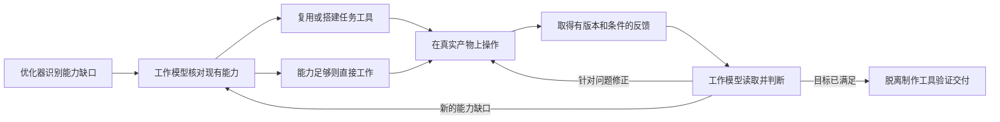

# 按任务构建临时工具箱：实施计划 v0.1

状态：已进入实施。P0 开发探测已登记，P1 可选提案与能力摘要链路已实现并通过回归；真实工具试点、任务工具耐久索引、效果对照和当前宿主加载验证尚待完成。进度与证据见[实施记录](TASK-TOOLBOX-IMPLEMENTATION.md)。代码基线为本地提交 `8238ec1`；GitHub 推送与发布继续暂停。

目标：让拦截优化模型识别影响任务质量与效率的能力缺口，判断是否值得复用、扩展或搭建任务内工具；由工作模型把这些能力做成可调用、可观察、可重复使用的工作手段，再用它们推进实际产物。HTML + Three.js 是首个验证场景，核心判断适用于其他任务。

## 1. 已确认的方向与待验证的假设

用户希望把一部分重复推理、手工操作和观察成本，转化成可复用工具及高反馈的工作循环。用户描述当前复杂任务经常消耗约 20–60M token，并愿意投入工具建设成本；这支持进行实践，但不等于已经证明几 M token 就能建成工具箱或保证总量下降。

本功能追求两类收益：提高实际成品上限；降低反复修改、重新理解现场和重复验证的成本。建设成本必须计入结果，但不能因为前期多用了 token 就直接否定方案。沿用现有优化包预算；工具建设发生在工作模型任务中，与优化器单次输出预算是不同的量。

需要验证的核心假设：

- 把重复操作封装成稳定接口，能让工作模型把更多判断用于形体、行为与设计，而不是反复维护坐标、操作脚本和检查环境。
- 反馈包含对象、版本、条件、结果及可检查的证据时，比孤立截图或一句“运行成功”更能指导下一次修改。
- 任务内工具经过实际复用后，整体质量或完成效率优于当前流程；不能只用“生成了工具目录”证明收益。

Blender 与 Three.js 的差距包含编辑操作、领域库、资产、观察手段、渲染配置和模型使用方式等因素。此计划只验证可由工具与反馈改善的部分，不预设 Three.js 质量上限，也不承诺重建 Blender。

## 2. 功能边界与职责

| 角色 | 本功能中的职责 | 边界 |
|---|---|---|
| 拦截优化模型 | 判断值得补哪种能力、理由、预期用途和反馈需求 | 保持方向级；不写工具实现、命令清单或固定建模步骤；不凭空断言工具不存在 |
| 工作模型 | 查明环境，选择复用/扩展/新建，搭建并试用工具，解释反馈并修改产物 | 具体语言、库、文件组织与实现由它结合工程决定；工具建好不等于任务完成 |
| 插件宿主 | 传递能力事实、归一可选提案、记录实际调用与结果、隔离会话和版本 | 不自动执行模型生成的代码，不把提案提升为用户要求或成功证据 |
| 顾问 | 在能力瓶颈、低信息返工或实际产物需要改善时提供点拨 | 沿用现有入口；不成为工具创建的固定审批节点，不逐次强制咨询 |
| 拦截 UI | 显示与允许编辑本轮将发送给工作模型的内容 | 不新增代替工作模型提问的选项按钮；预览、确认后的内容与实际注入一致 |
| 用户 | 决定目标、偏好和改变交付边界的取舍 | 常规工具实现选择不反复问用户；确需拍板时由工作模型调用 ask_user_question |

不可改变的产品约束：

1. 用户明确的技术路线继续生效。指定 HTML + Three.js 时，不能默默改成 Blender 建模路线。
2. “交付单文件 HTML”与“制作期间只允许一个文件”分别理解。前者通常容许本地制作工具，后者必须遵守；确有冲突再通过 ask 问用户。
3. 复用已有能力优先，但先依据可核对的环境事实；已注册工具不等于调用成功，历史成功不等于当前环境可用。
4. 工具不得自行定义新的审美或验收目标。测量和截图帮助判断，不能单独宣布“真实、帅气、精细”已经达成。
5. 全局优化关闭时不产生本功能内容；顾问关闭不妨碍工作模型建设和使用工具箱。
6. 临时是任务作用域，不是做完立即删除。保留复现和交接所需的入口与证据，停止自己启动的临时进程；不清理用户已有文件。

## 3. 现有代码提供什么，还缺什么

以下基于本次实际读取的源码；旧计划仅用于理解历史，不把历史“已实现”表述当成当前能力证明。

| 接入位置 | 当前可复用能力 | 本功能要补的部分 |
|---|---|---|
| [optimizer-protocol.js](../po06/lib/optimizer-protocol.js) | 组装优化器提示词，解析 intent / clarify / add / ask / decide，渲染注入文 | 可选工具箱提案、能力摘要输入、独立工作方法段；仅有工具箱内容时也能发包 |
| [interpreter.js](../po06/lib/interpreter.js) 与 [pipeline.js](../po06/lib/pipeline.js) | 解释输出归一、当前输入校验、状态提交、把包送入工作上下文 | 新字段走完链路，坏的可选字段局部降级；避免工具箱提案被判为空或只在预览里出现 |
| [index.js](../po06/lib/index.js) | 模型调用装配、请求记录、工作上下文和工具事件接线；已有 schemas 读取点 | 取得当前会话真实可见的相关能力摘要；不能用其他会话工具表代替；把后续工具事实送到恰当上下文 |
| [capability.js](../po06/lib/capability.js) | 当前输入与任务来源、native/PTC 工具证据、会话存储、重复失败观察 | 提案和任务内工具事实分开；新输入会重置 optimizer，工具事实需要独立的任务作用域承接 |
| [settings.js](../po06/lib/settings.js) 与 [policy.js](../po06/lib/policy.js) | 全局/会话设置、生效策略、注入包形状失效 | 若增加实验开关，贯穿归一、白名单、会话覆盖、policy、包失效及状态展示 |
| [advisor.js](../po06/lib/advisor.js)、[advisor-materials.js](../po06/lib/advisor-materials.js)、[advisor-evidence.js](../po06/lib/advisor-evidence.js) | 顾问入口、真实材料、证据引用与范围检查 | 顾问能看到具体工具收益/缺口；源码存在、预览成功和成品达标分别报告 |
| [ask-instruction.js](../po06/lib/ask-instruction.js) | 统一指示工作模型用选项提问 | 只承接真正的用户取舍，不把“是否安装着某工具”一类可查事实推给用户 |
| [client.js](../po06/lib/client.js) 与 [control-api.js](../po06/lib/control-api.js) | 拦截包预览/编辑、实际请求与状态展示 | 首版复用文本预览；后续按需要显示提案、已建工具、验证状态，不先做新工作台 |

[feedback.js](../po06/lib/feedback.js)里的历史自动返工预算不是本功能的成本策略；不直接套用其固定轮数或时限。现有图像/工具事件也不能证明浏览器支持截图、任意脚本可运行或新工具可动态注册，这些要单独实测。

## 4. 何时推荐工具箱

判断依据是任务结构，不是看到“Three.js”“建模”或“长任务”关键词就触发。

| 情况 | 建议动作 | 工作模型下一步 |
|---|---|---|
| 短答、单次小改、现有操作足够 | none：不新增工具箱段落 | 直接完成任务 |
| 已有相关工具且有可用证据 | reuse：复用 | 对当前对象核对适用性，直接使用 |
| 明显存在重复操作或关键反馈缺口 | build：扩展已有能力或搭建任务内工具 | 先做能服务真实子任务的最小能力，再随产物需要扩展 |
| 有潜在收益，但环境或既有工具未知 | inspect：先查明能力 | 工作模型查看当前工具、已有入口或做小探测，再决定是否建设 |

以上枚举是实现建议，尚未进入协议。关键语义是允许“无需搭建”“已有工具足够”和“目前不知道”作为完整有效结果。

优化器考虑：哪些操作会反复出现；错误定位有多难；反馈是否缺少稳定条件；已有工具能否覆盖；工具建设会不会延后主产物却不带来可复用能力。不给固定复杂度分数、不用任务字数代替判断，也不要求给出不可信的精确 token 回报预测。

## 5. 两份不同的契约

### 5.1 优化器输出：能力提案

建议在现有 optimizer 对象里增加可选的 toolbox 字段，缺失或 none 时保持当前行为。该字段不改变原话、不创建验收项，也不代表执行者已经采纳。

建议字段：

| 字段 | 内容 |
|---|---|
| recommendation | none / reuse / build / inspect |
| reason | 任务中的哪个重复负担或反馈缺口值得处理 |
| basis | 当前可核对的能力事实引用；未知明确保留未知 |
| capabilities | 所需操作能力及其预期输入、输出、使用场景；采用自然语言描述 |
| feedback | 修改后需要取得何种反馈，以及反馈如何影响下一次动作 |
| firstUse | 工具首先服务的真实子任务，防止只搭基础设施不做产物 |
| stopWhen | 不再扩建的条件，例如已覆盖当前重复工作、继续扩展没有新增用途 |

对象 ID、session、task、input 关联和运行状态由宿主绑定，模型不填写权限或成功标志。真正需要用户决定的内容仍走现有 ask / decide，不在 toolbox 内再造一套提问协议。

容错：未知或格式错误的 toolbox 只丢弃该字段并记原因；有效 intent / add / ask 继续保留。自定义提示词及旧版本响应可以完全不返回 toolbox；升级不能把旧格式变成错误。提案结构设独立版本标识，并记录实际使用的提示词版本；是否升级外层协议版本，以兼容测试结果决定，不先破坏现有 v3 读取条件。

当前链路的具体陷阱：本文的 toolbox-only 指“有效 intent + toolbox，其余 clarify / add / ask / decide 数组为空或省略”，并非省掉 intent。解释入口依赖 intent 选择 v3；解析器只保留既有四个内容数组，新增字段尚不会自动透传；渲染器的 hasBody 也只检查这四类内容。有效 intent、没有 patch 时现有流程可以正常理解成功，因此不能把修法写成“有 toolbox 就强制重试”。应扩展解析、归一、渲染和统计，并分别表达“无条目补丁”“无辅助正文”；保留原有空建议成功路径。

P1 还需核对三处隐性接线：输入构造器仅序列化已列字段，把 capabilitySummary 传给上层函数不等于发给模型；normalizeCollaboration 当前严格接受 optimizer.version 为 3；只读工具循环的 finalNote 仍写死旧字段清单。输入、主/回退输出契约、存档读取和请求记录要同步，不能只改一个提示词常量。

### 5.2 工作模型产出：实际工具及使用说明

提案落地后，工作模型提供一个任务内可读取的能力说明；可用简短清单或清单文件实现，文件名不在首版写死。它应能回答：

- 工具服务哪个对象和任务；如何用现有执行工具调用。
- 接收什么输入；修改什么对象；返回哪些数据或证据。
- 依赖哪些环境能力；当前已测范围和已知限制是什么。
- 最近一次实际试用对应哪个调用、产物版本和结果。
- 后续修改如何复用；如何恢复产物、停止工具进程及交接。

工作模型可以在这里写实现代码和命令；优化器的方向级限制不应错误地限制工作模型施工。

首版不要求生成 MCP、注册宿主工具或搭完整 Web 编辑器。能由现有 shell / 代码执行工具调用的项目脚本，也可以是有效工具。若后来动态注册明显有收益，再单独验证宿主接口。

## 6. 能力环境如何进入优化器

给优化器提供与当前任务相关的事实摘要，而不是整份工具 schema 或全工程扫描结果：

- 当前会话工具表中可见的执行、读取、浏览器、图像和建模等能力；标记来源及观测时间。
- 本任务已经建立的工具入口、最近试用结果和适用对象。
- 已有真实失败，例如浏览器未连接、工具参数不兼容；标记失败范围，避免把一次失败写成永久不可用。
- 不知道的部分明确列为 unknown。未读文件、工具目录中同名项目、另一个会话的工具，都不是当前可用证据。

默认复用本轮已有上下文、工具表与已授权材料，不固定增加一次顾问调用或扫描任务。环境不足时输出 inspect，让工作模型按现有授权查证。

宿主当前虽有 schemas 读取点，但能否获得“本会话实际可见”的完整工具集合需要在 P0 验证；拿不到时如实缺省。当前诊断 listTools 在查询失败时返回空数组，并可能取首个 agent 或全局表，不能直接当成本会话权威快照。摘要应带 scope、source、observedAt、coverage 或失败原因；查询失败、范围不完整属于 unknown，不等于工具列表确实为空。

优化器自身的 readTools 关闭或没有 cwd，只说明它的只读查询未启用，不能推出工作模型没有执行、浏览器或截图能力。图像工具存在还需区别“能产生图片”和“当前工作模型能接收并观察图片”。

## 7. 注入与执行顺序

建议注入顺序：需要用户决定的 ask 动作 → 本轮工作方法中的工具箱判断 → 原话、理解与成品方向建议。顺序用于表达职责，不伪造系统级权限，也不覆盖用户显式决定。

工具箱段要求工作模型处理一个明确事项：核对提案与当前环境，然后复用、搭建、缩小方案或有依据地放弃。不会把“优化器提了 build”变成无条件建设命令。ask 段则保持已经验证可触发提问的独立结构，不能重新埋进建议段。

示例（仅示意，非所有 Three.js 任务的模板）：

> 【本轮工作方法：按需补齐制作与反馈能力】
> 这项任务需要反复调整复杂形体并比较装配关系。先检查现有工程是否已有可复用的部件修改、稳定视角观察和版本比较能力；覆盖不足时，在当前任务内补齐最先需要的能力，并直接用它完成一个实际修改。让反馈能定位到部件和版本，支持下一轮修正。具体实现由工作模型结合环境选择；继续遵守单文件 HTML 的交付要求。已有能力足够时直接复用。

无收益时允许不建设；给出当前判断依据即可，不为这一可逆实现选择另开 ask。是否真正采用，不靠这段文字存在判定。

## 8. 反馈闭环怎样算成立

闭环需要可核对的链条：某个动作改变了真实产物 → 工具在明确条件下取得结果 → 工作模型读取结果 → 下一步针对其中的问题作出修改或有依据地保留当前版本。

反馈记录建议包含：任务/产物版本、操作对象与输入、执行是否成功、观测条件、结果数据、图片或日志引用、警告和未验证项。成功、失败、超时和部分产出都保留，不能只返回“已完成”。

这里需要新增生产接线：真实调用结果 → 绑定任务、入口及版本的工具事实 → 独立持久化 → 优化器与工作模型上下文摘要。现有 observe 主要保存调用计数和失败，collectToolEvidence 当前服务顾问路径，observer 也没有成功工具入口或已验证能力视图；不能把这些现有组件描述成闭环已接通。通用 shell 命令退出成功，只证明该命令结束，具体能力仍需关联实际对象与结果。

如果工具需要视觉判断，必须真的产生图像并通过现有工具交给有图像能力的工作模型。仅打印图片路径、生成截图脚本或返回 base64 字符串，不算模型已经看过。图像、日志和几何检查按各自范围使用。

工具层可批量执行确定性操作，例如同条件渲染多个参数候选；工作模型负责解释反馈和选择。没有真实图像评价能力时，不把程序自评分当作美学判断，也不自动挑“分数最高”的结果作为成功。

版本号、哈希帮助匹配实际证据，不机械推导“旧工具失效”或“新版本更好”。工具接口能运行、检查能发现缺陷、产物质量有提升，是三件要分别验证的事。

## 9. HTML + Three.js 试点

以用户已指定 Three.js 的复杂车辆任务作为首个正例，在它的环境里选择需要的能力，不要求整套必做。

| 候选能力 | 实际用途 | 验证方式 |
|---|---|---|
| 稳定部件寻址与参数修改 | 根据反馈修改车身、轮组或座舱关系，避免每次重新定位大量源码 | 后续不同修改继续使用同一入口；对象映射与改动结果能核对 |
| 部件尺寸/位置/间距查询 | 发现不合理比例和可疑装配关系 | 使用已知错位或间距构造验证检查器；包围盒重叠只能标可疑，不能冒充精确穿插判定 |
| 固定视角与显示模式捕获 | 比较形体、线框、材质和光照，减少机位变化遮蔽问题 | 相同场景版本、相机、视口、时间点；实际图片由模型读取 |
| 版本快照与前后对照 | 判断局部修改是否改善、是否伤及整体 | 可回到前版并在相同条件对比，不用“文件变了”代替收益 |
| 可复用交互与性能采样 | 对同一驾驶/操控过程复验响应与运行负担 | 记录实际事件、采样条件与原始值；静态截图不能证明交互或帧率 |
| 成品打包和脱离工具验证 | 保证工具不会变成交付依赖 | 停止制作服务，在规定环境打开最终 HTML 并检查资源依赖与主要行为 |

首个可演示闭环：选择任务中一个真实待改部件，取得当前状态与可见证据，进行一次修改并生成同条件对照；再处理另一个实际修改，验证工具能被复用而不是一次性演示脚本。

上述“多视图、部件、驾驶”只属于试点，不写进通用触发器。另选数据分析或界面交互任务验证机制可迁移，避免把功能做成固定车辆模板。

## 10. 跨轮复用与生命周期

提案是本轮机器判断；实际建成的工具是带证据的任务资产。两者不能共用“每次输入清空 optimizer”的生命周期。

- 同任务继续：带入相关工具入口、已测范围及新失败，不重复注入全部工具源码或建设说明。
- 新阶段出现新能力缺口：允许补一小项，不自动重建整箱。
- 用户改变约束或工具版本：只重新核对受影响的能力；旧事实保持来源与时间。
- 切换任务/工程/会话：停止把旧工具当当前可用；若有复用价值，先核对路径、环境与适用性。
- 重启：恢复的是已记录入口和历史证据，当前进程/浏览器是否存活重新核对，不能直接恢复为可用。
- 取消：停止本功能负责的在途工作，迟到结果不覆盖新输入；保留已有产物，不自动删除。
- 收尾：记录仍需保留的工具和复现入口；关闭自己启动的临时进程；最终产物按原要求独立交付。

首版必须有最小耐久索引：工具事实独立版本化保存，绑定宿主持有的 task 身份、profile、session 与 workspace，不能挂在本轮 optimizer/message/epoch 上。当前 capability 保存字段不含成功工具事实，且重启仅回放最后一次真实输入之后的事件，靠会话回放不能保证恢复。调用开始时就绑定任务及入口；结束后按原归属记录，旧任务迟到结果不得挂到当前新任务。

任务身份不能直接等同于会变化的 sourceRequestId：拦截输入 ID 在实际提交后可能映射成人类消息 ID。应保存稳定任务键与输入别名关联；continue 延续，uncertain 保留工具事实但重新核对适用性，new 或换工程建立新的归属。

工作模型读取任务内工具说明承接细节，插件索引只保存必要入口、验证范围与证据引用。更复杂的共享注册中心可以后续评估，但上述最低限度的持久化、归属与迟到保护不能推迟成可选增强。

## 11. 分阶段实施计划单

阶段表示开发依赖，不是给所有用户任务强加相同流程。每阶段的测试和现场验证各自记录；局部通过不能替代最后的成品与收益比较。

| 阶段 | 工作与具体交付 | 通过条件 |
|---|---|---|
| P0 基线与接入探测 | 冻结当前版本、设置、模型和样例；核对当前会话工具表、图像回传、原始结果引用和实际加载标记 | 对已知/未知能力能给出处；开发环境可跑最小操作并把反馈交给工作模型；尚不可用的能力如实列出 |
| P1 优化器判断与协议 | 添加可选 toolbox 提案、输入能力摘要、独立渲染；沿现有解析、pipeline、capability 存储走完整链路 | none/reuse/build/inspect 可区分；toolbox-only 能显示和注入；坏字段不吞原包；自定义提示词与旧响应兼容 |
| P2 工作模型建工具试点 | 在真实 Three.js 任务中由工作模型检查、复用或创建工具；留下能力说明与首次实际用途 | 有真实调用、结果和模型观察；至少覆盖实际首次使用与后续复用；不以口头“我会建”或生成空目录算成功 |
| P3 状态承接与异常 | 最小耐久工具索引、调用起点任务绑定、迟到保护、取消与重启；真实结果经事实索引进入优化器及工作上下文 | 同任务不无端重建；跨任务不串用；重启保留入口并复查当前可用性；故障和证据范围明确 |
| P4 对照与消融 | 固定任务与质量口径，比较当前版、仅增加工具箱提示、完整工具与反馈三种条件 | 同工作模型下记录成品差异、后续修改、总开销和实际闭环使用；失败样本保留，不能只挑最好一版 |
| P5 本地试用与回滚 | 复用现有预览和详情展示；确认开关、跳过、顾问关闭及旧包降级行为；写使用说明 | 当前 GUI 和当前工作模型真实接通；能关闭并恢复基线；是否默认启用由收益证据决定，发布另行处理 |

建议顺序：P0 → P1 → P2；P2 的事实驱动 P3；P3 稳定后进行 P4、P5。P1 只证明“会提出建议”，不称功能完成。

### 实施改动清单

- [ ] P0：登记基线、自然任务、实际可见工具来源及图像可达性。
- [ ] P1：在优化协议中加入可选提案；宿主分配关联 ID，解析时保留来源身份。
- [ ] P1：核对输入字段序列化、主/回退输出契约、interpreter → pipeline → collaboration → capability 存储 → 实际注入；同时区分无 patch 与无正文。
- [ ] P1：补 toolbox-only、旧响应、异常字段、中文/英文、自定义提示词、取消与跨会话测试。
- [ ] P2：形成由工作模型实际生成或复用的工具、入口说明、操作反馈和后续复用证据。
- [ ] P2：真实运行中的工作模型完成使用与修正；顾问口头评价不算工作模型行为实验。
- [ ] P3：把已建工具事实从本轮提案中分离并耐久保存；调用开始时绑定任务，验证继续、任务 ID 映射、换工程、约束变化、迟到与重启。
- [ ] P3：让反馈能被观察并影响下一步；记录错误、部分结果和工具自身限制。
- [ ] P4：运行开发样例后冻结策略，再做独立样例对照；成本包括建设、调试、失败与维护。
- [ ] P5：核对本地加载、预览与实际注入一致、关闭/回滚；保留用户原有配置。

如代码复杂度需要拆分，候选新模块为 toolbox-proposal、toolbox-context、toolbox-state；模块名和拆分粒度在实施时决定。先复用现有协议与事件，不为了计划里的名称强造三个模块。

## 12. 测试与现场证据

### 工程检查

1. 无工具箱需求时没有多余段落、目录、询问或固定顾问调用。
2. 有效 intent + toolbox 且其余内容数组为空时，包不是空；没有 patch 不被统计成没有正文；可选字段损坏时，原话、建议和 ask 不丢。
3. 能力未知不变成“没有工具”；注册成功不变成“已实测可用”；其他会话工具不误带入。
4. 建议被显示、工作模型读到、真实调用工具、读取反馈、修正产物，分别有可查记录。
5. 状态序列覆盖同任务承接、任务切换、用户改口、取消、并发与重启；关键绑定由宿主确认。
6. 图像、工具输出和成品版本对应；没有图片附件时不得记录模型已完成视觉检查。
7. 工具停用后交付物仍符合单文件/离线/依赖约束；不把运行平台限制升级成新的用户要求。
8. 既有 ask 工作模型提问链路、顾问开关、英文任务及拦截跳过行为不退化。

### 自然任务对照

建议初始开发样例覆盖：复杂车辆形体与操控、已有 Three.js 工程的连续修改、具有同类反馈需求的非建模任务；另用单次小改、已有工具齐全、环境不可用或读写受限作为反例。样例和通过口径在跑候选之前登记，不写成运行时行业规则。

同一任务至少区分当前流程、工具箱提示、实际工具与反馈三种实验条件。保持原话、工作模型、主要可用资源、交付要求和评价条件一致；候选组建设时间与 token 计入总量。若多样本成本很高，先做有限探索并明确样本范围，后续再重复验证，不能把一次成功推广成通用效果。

| 观察项 | 记录方式 |
|---|---|
| 成品质量 | 对照同一用户目标和已约定口径；视觉使用统一条件展示与不知道分组的比较，交互使用真实操作 |
| 闭环是否发生 | 工具调用 → 原始结果 → 工作模型实际读取 → 后续修改/保留理由，按时间和对象关联 |
| 工具是否复用 | 首次建成后的不同实际修改是否继续使用该入口，使用次数不是越多越好 |
| 修改效率与回归 | 发现问题到正确修改的过程、重复操作量、其他部件/行为退化与返工 |
| 全任务代价 | 优化、工具建设、产物实现、失败、顾问、反馈与收尾的 token/耗时；缓存输入和实际计费分列 |
| 不良副作用 | 无用工具、长期只修脚手架、无依据换路线、过多询问、把自评分当成验收 |

保留候选的依据：观察到更好的结果或有价值的效率收益，且关键约束和交付可用性未退化。质量提高但成本增加，可以报告为“质量收益、有额外成本”，不强求必须同时节省 token。无收益则收窄或撤回机制，不靠加规则、延长循环或换强模型掩盖。

## 13. 常见失败与应对

| 失败方式 | 应对 |
|---|---|
| 每个任务先搭一套框架 | none/reuse 作为正常结果；建设依据必须对应当前能力缺口 |
| 工具越搭越多，主体没推进 | 每项新能力绑定真实首次用途；已经满足重复工作时停止扩建 |
| 只有截图，没有能改的入口 | 检查反馈能否定位到对象、能否通过稳定操作修正；观察能力与编辑能力配对 |
| 工具与产物共用同一错误假设 | 用已知正确/错误的小构造检验工具；保留独立观察，不让同一个自检脚本自证全部质量 |
| 大量截图/日志挤满上下文 | 摘要保留对象、条件、变化与异常，原始证据可定向读取；不把体量误当高反馈 |
| 当前模型没有图像能力 | 先确认可用观察通道；不能用文本自述“看到了”补空缺，必要时保留限制或交给用户决定 |
| 下一轮又建议从零搭 | 区分短期提案和已验证的任务工具事实；按相关性带入入口与范围 |
| 单文件交付依赖制作服务器 | 脱离工具验证成品；真实无法满足时由工作模型 ask 用户，不能悄悄改交付口径 |

## 14. 开关、预算与仍开放的决定

建议首版以本地实验方式可关闭，与优化档位、顾问开关分别表达；是否增设 toolboxMode=off/auto、默认在哪些档位启用，留待 P0/P1 明确。若添加设置，必须走完整 policy 和包失效链，不能出现只改 UI 的死开关。

关闭后停止新增提案及自动投影，撤销本功能迟到的注入；已经生成的工具文件保留，工作模型仍可依据用户原任务使用。回滚应恢复旧渲染路径并容忍存储里的可选新字段，不因关闭功能破坏已完成的产物。

本计划不设固定工具数量、建设 token 上限或循环配额。用户已表示愿意投入；控制点是每次扩展是否服务主任务、每次循环是否增加信息、是否仍遵守现有授权与取消机制。观察到重复无信息产出时调整方法，不把该现象直接当作需要用户批准继续。

仍需在实施中确定并记录：当前会话工具集合的可靠读取接口；工具说明的存放与恢复方式；制作工具与交付文件的边界表达；试点评价样例；是否有必要增加正式工具注册。常规可逆实现选择由工作模型处理，只有改变用户目标或交付边界时才调用 ask。

## 15. 完成定义与本次交付

本功能的完成证据应同时包含：合适任务触发且简单任务不滥建；优化器提案到真实工作上下文无丢失；工作模型实际构建或复用了工具；反馈推动了后续动作；跨轮可继续使用；最终成品符合原约束；对照中收益与成本如实报告。

提示词变长、目录变多、单测全绿、顾问说“建议采纳”，都不能单独替代上述证据。

本计划已按用户指令启动实施；当前阶段成果、测试和未完成项持续写入[实施记录](TASK-TOOLBOX-IMPLEMENTATION.md)。保持本地迭代，不推送或发布；完整功能完成仍以本节证据定义为准。
