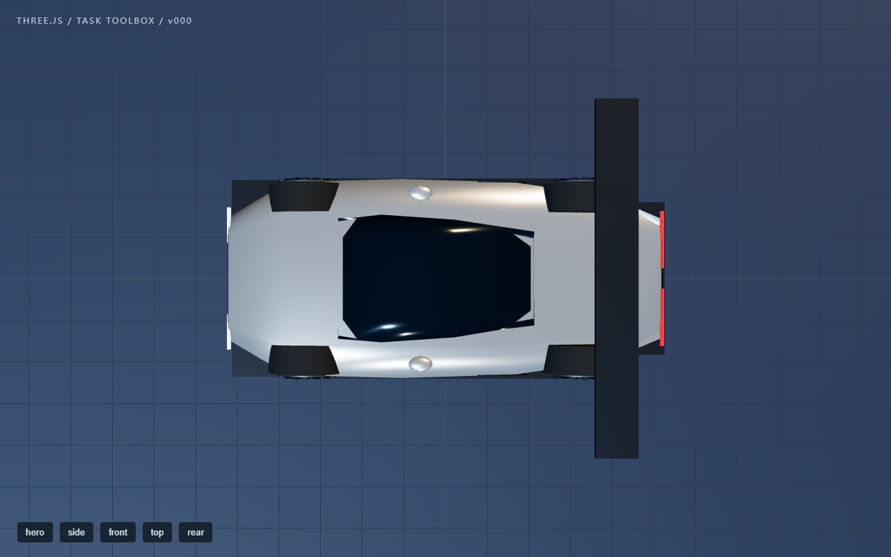
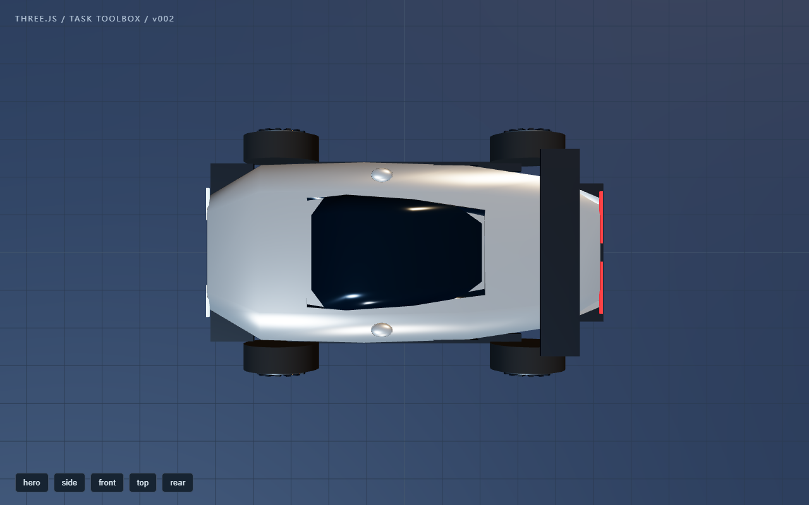
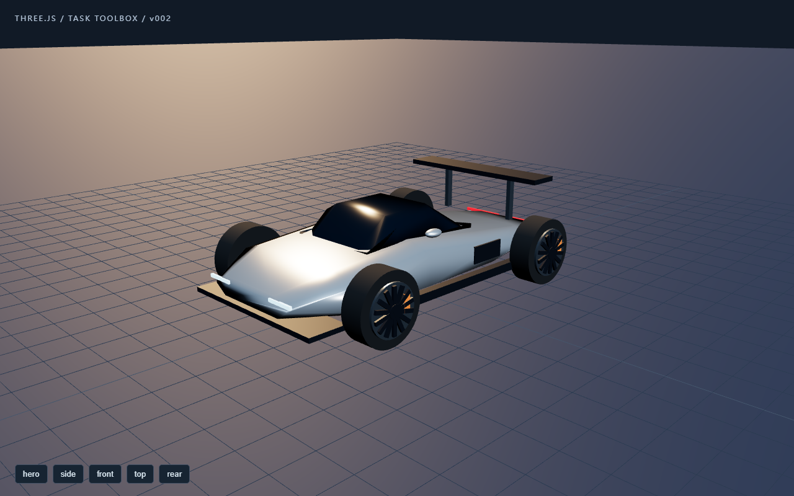

# Three.js 工作工具箱：受控开发试点结果

对应[预登记](PREREGISTER.md)。这是工作模型在本会话直接建工具、执行、观察与修正的真实工程试点；不是独立自然任务 A/B，不证明默认开启后必然省 token，也不证明概念车达到写实成品水平。

## 已完成的实际链路

[制作工具](toolbox.mjs)复用本机 Three.js，提供 init / inspect / edit / capture / export；[命名车辆模型](vehicle.mjs)保留车身、座舱、轮组和尾翼等部件身份。工作模型按以下顺序真实调用并读取了图片：

| 版本 | 动作与可核对反馈 | 后续决定 |
|---|---|---|
| v000 | 首次 inspect：轮组内侧与最大车身范围的间距约 -0.36；尾翼单侧外伸约 0.75；读取实际 hero/top 图像，看见轮胎缩进、尾翼明显过宽 | 先只改轮距 |
| v001 | 用同一 edit 入口把 wheel.track 从 1.8 改为 2.6；inspect 间距约 0.04、尾翼仍 0.75；再读取实际俯视图 | 保留轮组修正，再处理尾翼 |
| v002 | 再用同一入口把 wing.span 从 3.7 改为 2.35；inspect 间距仍约 0.04、尾翼外伸约 0.075；读取最终 hero/top | 两个受控装配问题均有对应改动，停止扩展工具，导出成品 |

测量只描述当前几何范围。间距用最大车宽近似，没有轮拱开口，也不是精确碰撞检查；概念车仍是简化几何、开放轮组，不能把修正数值当成“超跑已写实”。

## 实际画面

同条件俯视，初始版本：

同条件俯视，完成两次修正：

最终浏览器画面：

## 运行与失败记录

- 本机已有 Three.js 0.186.1、Node 和 Edge；没有下载模型、纹理或依赖，没有另起 DSH GUI 服务器。
- 首次隔离浏览器捕获超时在 Page.enable（约 29.1s）；调整启动参数后的第二次仍超时在 Runtime.enable（约 28.7s）。CDP 连接仍可回应 Browser.close，说明不是完全失去浏览器连接。
- 第三次在隔离浏览器增加 no-sandbox 后，WebGL 与固定机位截图恢复：初始约 6.9s、第一次修正约 6.3s、最终约 6.2s。此参数只用于本地受控生成页面的实验进程，不修改用户浏览器或产品设置，不将它写成通用截图要求。
- 三次成功 capture 都返回 1280×800、hero/side/top，页面 exceptions 为空、HTTP(S) 请求为空，渲染记录约 63 个 draw call、2870 个三角形。它证明当前固定画面可渲染，不代表性能基准或交互验收。
- 每次截图启动的浏览器已关闭；未接触用户日常浏览器进程。
- export 得到 6,075,874 字节的独立 HTML，Three.js 内联在文档中；与最终实际截图对应的 artifact.html 字节完全相同，SHA-256 为 e9ac3a6b412c5755ac4f2fe8b152c3f96db37c3445f4da50f954719c284977d8。捕获时已经阻断 HTTP(S)，仍可用 file URL 渲染，不依赖制作服务。

三版原始场景参数、工具结果、图像路径、时间和导出摘要保存在[实际输出记录](evidence/observed-results.json)。浏览器缓存和三份大型 HTML 留在本地试点目录，不将浏览器用户资料或完整依赖复制进源码仓库。

## P3 生产接线验证

[受控集成入口](check-integration.mjs)在新 Node 进程中使用真实 workshop inspect 的 stdout，通过生产 adapter 的事件处理函数写入独立工具索引。事件信封与解释器输出由测试入口构造，因此属于工程集成验证，不冒充当前 DSH 会话自然事件。

结果：一个工具入口进入优化器摘要和工作上下文；continue 后任务键保持；重新创建 store 后入口和实际历史调用仍在，currentAvailability 仍是 unknown，不把历史成功恢复成“进程仍可用”。原始结果也标出来源：任务/调用身份由宿主绑定，工具元数据与产物版本为工具自报；图像路径不会自动成为已观察证据。

另外已用单测覆盖 native/PTC、后台 job_output 回收、晚到旧任务、用户取消、拦截 ID 映射、跨工程/会话、失败报告、重复事件、重启，以及用户审查编辑不能被自动插回旧工具事实。

## 复现方式

使用本机 Node 执行，按环境提供已有 Three.js 和 Edge 路径；不要覆盖已有试点目录：

~~~text
node po06/experiments/task-toolbox/toolbox.mjs init <新目录> --three-root <已有 three 包目录>
node po06/experiments/task-toolbox/toolbox.mjs inspect <目录>
node po06/experiments/task-toolbox/toolbox.mjs capture <目录> initial --edge <Edge 路径>
node po06/experiments/task-toolbox/toolbox.mjs edit <目录> wheel.track 2.6
node po06/experiments/task-toolbox/toolbox.mjs capture <目录> wheels-corrected --edge <Edge 路径>
node po06/experiments/task-toolbox/toolbox.mjs edit <目录> wing.span 2.35
node po06/experiments/task-toolbox/toolbox.mjs capture <目录> final --edge <Edge 路径>
node po06/experiments/task-toolbox/toolbox.mjs export <目录> <输出 HTML 路径>
node po06/experiments/task-toolbox/check-integration.mjs <目录>
~~~

查看截图和测量后再决定改动；上列数值仅用于复现这份受控构造，不成为通用建模规则。最终 HTML 支持视角按钮和拖动，但本轮未把点击/拖动自动化测试纳入证据。

## 尚未完成的证据

- 自然优化器是否合适地提出 none/reuse/build/inspect，并促使工作模型自主建设、使用工具。
- 与冻结基线相比的质量、维护与完整 token/耗时收益；本会话独立 token 计量不可用，明确缺失。
- 当前运行中的 DSH GUI/模型是否实际加载并消费新索引。受控新进程验证不替代 P5 的现场加载。
- 非建模任务迁移与无收益任务的“不搭建”行为。

因此本轮可确认 P2 的真实开发闭环和 P3 的工程接线；P4 自然任务/消融对照及 P5 现场加载与回滚继续保持待完成。
## P4 自然任务有限对照（进行中，未完成）

预登记见 [NATURAL-PREREGISTER.md](NATURAL-PREREGISTER.md)。全部调用走本机已安装的 DeepSeek 适配器与用户当前配置的 deepseek-official / deepseek-flash（reasoningEffort=max），通过隔离进程执行，不改当前会话设置，不启动替代 GUI。

### 优化器判断（4/4 完成）

| 样例 | 候选返回 | 关键理由 | 报告用量 |
|---|---|---|---|
| 单次按钮文案修改 | `none`（不注入） | 单点修改，无重复工作与反馈缺口 | 1864 |
| 已有实际使用记录的车辆工具，继续微调 | `reuse` | 已有可用入口，直接沿用 | 4376 |
| 重复复杂的机械装配迭代 | `inspect` | 先确认环境是否有本地渲染取帧与前后对比能力 | 3924 |
| 会话工具表查询失败 | `inspect` | 明确保留“未知”，未断言缺少工具 | 3894 |

四例没有出现“见到 Three.js 就强制搭工具”，也没有把查询失败写成工具缺失；样例数有限，不构成通用判断正确率。

### 工作模型行为（A / B 各一次，均未完成）

同一工程、同一脚本、同一任务与追加修改；差别只在辅助文本。工作模型可使用现成的 read/write/run/read_image，也能自行改造工程。

| 条件 | 请求数 | 工具调用 | 实际读取图像 | 结果 | 报告累计 token |
|---|---:|---:|---:|---|---:|
| A 冻结基线辅助 | 24（上限） | 30（5 次失败） | 3 | 场景停在 v000，最终导出的仍是未修改几何 | 46,973 |
| B 候选工具箱提案 | 24（上限） | 39（2 次失败） | 15 | 改到 v006，简单间距检查仍为 −0.25，未进入追加阶段 | 79,062 |

两组都在预登记的 24 次请求内**没有完成第一阶段**，追加修改阶段未运行。因此：

- 不能据此宣称候选提高了成品质量或降低了成本；B 用了更多 token、做了更多工具工作，仍未收口。
- 可以看到的是：B 确实读了 15 张真实截图并据此连续修改参数，建立了“观察→修改”的循环；A 读了 3 张，最终没有改动几何。这说明提案能改变行为路径，但不保证结果更好。
- A 的 5 次 / B 的 2 次工具失败都保留在原始记录中；失败包含路径写法、Node 模块格式与首次浏览器启动，属于模型与环境的真实摩擦，未手工修复后重跑。

原始精简记录见 [evidence/natural-comparison.json](evidence/natural-comparison.json)，逐次请求与工具输出保留在本地 `.po06-tmp/toolbox-natural/behavior/{A,B}/`。

### 结论与下一步

这轮对照**没有通过**“候选更好”的门槛，也没有给出相反的结论——它是上限截断导致的未完成。要得到可比结论，需要：更长的请求预算或更小的任务面、先做一次工具协议连通性预跑、并在正式对照前固定每阶段预算。C 组（任务工具事实回灌）尚未运行，因此该条件没有行为证据；其工程接线由 P3 单测与受控集成覆盖，不冒充自然对照结果。
## P4 重做：收敛判据明确的小任务面（A/B 各一次）

预登记见 [NATURAL-PREREGISTER-2.md](NATURAL-PREREGISTER-2.md)。同一句任务、同一停止判据（wheelInnerClearance > 0 且 |wingOverhang| < 0.15）、同一工程副本、单阶段、上限 18 次请求。

| 条件 | 请求 | 工具调用 | 实际读图 | 最终场景 | 判据 | 报告累计 token |
|---|---:|---:|---:|---|---|---:|
| A 基线辅助 | 18（上限） | 23（2 次失败） | 4 | v002, track 2.6, wing 2.4 | 0.04 / 0.10 ✅ | 132,193 |
| B 候选提案（inspect） | 18（上限） | 33（5 次失败） | 14 | v002, track 2.76, wing 2.3 | 0.12 / 0.05 ✅ | 62,546 |

两组都在 18 次请求内到达数值判据，但**都没有在到达后停止并声明完成**，因此按预登记记为“触上限”，而不是“完成”。可比较的事实：

- 候选组读了 14 张真实截图、做了 33 次工具调用；基线组读 4 张、23 次调用。候选确实把更多轮次花在观察上。
- 报告累计 token 反而是基线更高（132k vs 63k），与“候选更贵”的猜测相反；单次运行不足以支撑任何成本结论。
- 两组最终轮组/尾翼参数不同，都满足同一个几何判据；判据不衡量审美，因此**没有质量胜者**。

仍缺：C 组（任务工具事实回灌）的自然行为证据；多次重复与随机顺序；到达判据前“主动停止”的行为（两组都表现为持续打磨，这本身是一个值得修的产品现象——注入文已写停止条件，模型没有执行）。

## P4 第三次：三臂（A/B/C）同判据
预登记见 [NATURAL-PREREGISTER-2.md](NATURAL-PREREGISTER-2.md)。C 组在 B 的基础上开启真实调用绑定的任务工具事实回灌。

| 条件 | 请求 | 工具调用 | 实际读图 | 最终场景（track / wing / bodyW） | 判据 | 累计 token |
|---|---:|---:|---:|---|---|---:|
| A 基线 | 18（上限） | 23（2 失败） | 4 | 2.6 / 2.4 / 2.2 | 0.04 / 0.10 ✅ | 132,193 |
| B 候选提案 | 18（上限） | 33（5 失败） | 14 | 2.76 / 2.3 / 2.2 | 0.12 / 0.05 ✅ | 62,546 |
| C 提案＋工具事实 | 18（上限） | 28（3 失败） | 8 | 2.30 / 2.0 / 1.9 | 0.04 / 0.05 ✅ | 75,561 |

原始记录：[natural-comparison-3.json](evidence/natural-comparison-3.json)。

### 结论（明确不构成胜出）

- 三组都达到了数值判据，**三组也都在达标后继续做到请求上限**，没有一组主动声明停止。这是本轮最稳定的行为观察，且与“停止条件已写进任务文本、候选提案也带 stopWhen”相矛盾。
- C 组通过改变车身宽度达成判据（2.2→1.9）——任务措辞允许，但形变比 A/B 大，所以三组的最终形态不可直接按“谁更好”排序。
- 单次运行、单任务，没有统计意义；不据此宣称质量提升或成本下降。B 组累计 token 最低这一结果与“候选更贵”的直觉相反，同样不推广。
- 已据此修改产品行为：工具事实段在存在停止条件时会显式打出「停止条件：…」，把它从“任务文本里的一句话”变成每轮可见的约束；单测已覆盖（无 stopWhen 时不出现、pending 时整段隐藏）。

### 仍缺

- 多次重复与随机顺序；审美质量的人工判定；C 组 stopWhen 生效后的复测（本次运行用的是回灌前构建的 runner 配置，停止条件投影尚未进入该次运行）。
- P5 现场加载：运行实例仍是旧模块（`previewRevision` 仍为 `advisor-loop-1`），需一次重启后核对。

## 停止条件投影复测：无结论

为验证「每轮显式打印停止条件」是否真的让工作模型停止，用同一任务、上限 12 次请求重跑 C 组（工具事实 + stopWhen 投影）。结果：12 次请求全部用于探索与截图（19 次工具调用、5 张实际读图、5 次工具失败），**场景停在 v000，从未到达停止条件**。

因此这次复测**不构成对 stopWhen 投影的验证**：既不能说明它有效，也不能说明它无效——它从未被触发。[记录](evidence/stop-hint-retest.json)。

要真正验证，需要一个"先到达判据、再观察是否停止"的运行：更大请求预算，或从已达标场景起步只用少量预算测试停止行为。下一轮按后者做，成本更低。

## 停止条件验证的第三次尝试：未开始，撞到真实输出形状错误

改用低成本方案（从已达标场景起步、6 次请求）。但在**准备阶段**就失败：基线优化器返回了 `"intent": "…"`（字符串），而契约要求 `{text, relation}` 对象，解析器按严格规则判 `BAD_OPTIMIZER_SHAPE`，该轮不会产出注入包。

记录到的实际用量：1 次调用、3,320 token、13.5 秒、`finish: stop`。这不是本次工具箱改动引入的——基线用的是冻结提示词，`toolboxMode` 关闭；属于既有的模型输出形状波动（此前 5 次 prepare 都成功）。

影响与取舍：

- 用户可见后果是**这一轮没有注入包**（原话照常发送），不是错误弹窗；
- 现有策略是严格拒绝、不猜补，这与「不把假设写成要求」一致；把字符串强行升级成对象会悄悄制造 relation，风险更大；
- 因此本轮不改解析器。若之后要提升鲁棒性，应作为独立改动：只接受显式可判的降级（如字符串 + 明确无 relation 时标 uncertain），并配单独测试与失败计数。

结论：停止条件的**行为验证仍未完成**（这次连前一步都没跑起来）。已如实留存，不记为通过。
## 停止条件验证：已达标起步，仍然不停（否定结果）

复用上轮真实提案快照（不新增优化器调用），把场景预置为**已满足判据**（clearance 0.04、overhang 0.10），只给 6 次请求，并每轮打印「停止条件：…」。

结果：6 次请求全部用完，13 次工具调用、3 张实际读图；场景从 v010 被改到 v011（track 2.54、轮宽 0.28、wing 2.48，clearance 0.03 / overhang 0.14）。改动后仍满足判据，但**模型没有在达标时停止**。

这是一个**否定结果**：把停止条件从“任务文本里的一句话”提升为“每轮可见的约束”，在本例中没有改变停止行为。它只提高了可见性，不构成遵从性保证。

产品含义：不宣称 stopWhen 能约束模型停止；它是提示，不是闸门。若确实需要硬约束，得另做机制（例如宿主侧在检测到达判据后主动结束工具轮次），那属于超出本计划范围的新决定。

[记录](evidence/converged-stop-test.json)。
